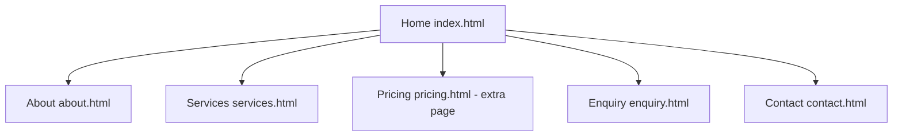

# FixPoint Website Prototype

**Module:** WEDE5020 Web Development  
**Student:** Phetogo Moiloa  
**Student number:** ST10217316  
**Group:** 1

## Project overview
FixPoint is a fictional South African device-repair service created as an educational website project. The website helps visitors understand available repair services, view example prices, submit a repair request and make a general enquiry.

The concept was selected because it provides a practical, clearly defined service and a straightforward user journey. It is not presented as a real operating business.

## Website objectives
- Explain phone, laptop and tablet support services.
- Present example assessment and support prices clearly.
- Make it easy for visitors to submit a repair request.
- Provide contact information and a general enquiry form.
- Present a consistent experience on desktop and mobile screens.

## Sitemap

`pricing.html` is an additional page beyond the required five and is documented here as required.

## Technologies
- HTML5 for page structure and content.
- CSS3 for layout, typography, responsive styling and visual design.
- JavaScript for the mobile navigation and client-side form validation.

## Folder structure
```text
FixPoint_Website_POE/
├── index.html
├── about.html
├── services.html
├── pricing.html
├── enquiry.html
├── contact.html
├── robots.txt
├── sitemap.xml
├── _headers
├── css/
│   └── style.css
├── js/
│   └── script.js
└── documentation/
    └── PROJECT_NOTES.md
```

## Running the website
Open `index.html` in a modern web browser. No build tools or package installation are required. Google Fonts are loaded online; the site uses fallback fonts if they are unavailable.

## Forms and functionality
The booking and contact forms use browser validation and JavaScript feedback. They are demonstration forms only. They do not connect to a server, transmit information or store personal data. The sample prices are fictional examples, not commercial quotations.

## Testing checklist
- Check all five pages and navigation links.
- Resize the browser to desktop, tablet and mobile widths.
- Open the mobile menu and verify its expanded state.
- Submit each form with missing fields to test required-field validation.
- Submit each form with valid sample information and confirm the status message.
- Check keyboard navigation and the skip-to-content link.

## Changelog
- **Version 2.0 (Part 1 gaps):** Added `about.html`; renamed `booking.html` to `enquiry.html` to match the brief; added About to navigation and footer on all pages.
- **Version 2.0 (Part 3):** Rewrote `js/script.js` with inline validation, SA phone check, AJAX submission, estimate response, email compiler, accordion, catalogue search/filter/sort and reveal animations.
- **Version 2.0 (Part 3):** Added Open Graph and canonical tags, `robots.txt`, `sitemap.xml` and `_headers`.
- **Version 2.1 (Part 3):** Added Leaflet map with three branch markers on `contact.html`; added gallery with lightbox to `about.html`; added `picture`/`srcset` responsive images (WebP with JPEG fallback) in `images/`.
- **Feedback edits:** *(add one entry per lecturer comment from the Part 1 and Part 2 feedback)*
- **Version 1.0:** Created the five-page website structure and shared navigation/footer.
- **Version 1.0:** Added responsive layouts and a consistent FixPoint visual identity.
- **Version 1.0:** Added service descriptions, illustrative pricing, booking form and contact form.
- **Version 1.0:** Added mobile navigation and client-side form validation.
- **Version 1.0:** Added project documentation and testing checklist.

## Part 2 summary (design)
External stylesheet `css/style.css` linked on every page; typography, Flexbox/Grid layouts, hover/focus states, `rem`/`%` units and media queries at 900px and 700px (multi-column to single column).

## Part 3 summary (functionality and SEO)
- **Interactive elements:** accordion FAQ, scroll-reveal animation (respects reduced-motion), advanced DOM rendering.
- **Dynamic content:** services catalogue rendered from a JavaScript data array with search, device filter and price/name sort.
- **Forms:** `enquiry.html` validates input and returns an estimated cost range and earliest assessment day; `contact.html` validates input and compiles an email the visitor sends to the recipient set in `js/script.js`. Both use client-side validation with inline errors; submission uses AJAX (`fetch`), which works with Netlify Forms once deployed.
- **SEO:** unique titles and meta descriptions, Open Graph tags, canonical links, semantic headings, `robots.txt`, `sitemap.xml`.
- **Security/speed:** `_headers` file (CSP, frame and content-type protection), deferred scripts, no third-party JavaScript.
- **Deployment:** deploy the repository root on Netlify or GitHub Pages and replace `fixpoint-wede5020.netlify.app` in `sitemap.xml`, `robots.txt` and canonical tags with your live URL.

## Project scope and limitations
This is a front-end academic prototype. It does not include user accounts, payment processing, a live booking system, a database, a repair tracking portal or a server-side form handler. The business, contact details and prices are fictional placeholders.

## References
- Google (2026) *SEO Starter Guide*. Available at: https://developers.google.com/search/docs/fundamentals/seo-starter-guide (Accessed: 2 November 2026).
- Mozilla (2026) *MDN Web Docs*. Available at: https://developer.mozilla.org/ (Accessed: 2 November 2026).
- Netlify (2026) *Forms setup*. Available at: https://docs.netlify.com/forms/setup/ (Accessed: 2 November 2026).
- Sitemaps.org (2026) *Sitemaps XML format*. Available at: https://www.sitemaps.org/protocol.html (Accessed: 2 November 2026).
- W3C (2023) *Web Content Accessibility Guidelines (WCAG) 2.2*. Available at: https://www.w3.org/TR/WCAG22/ (Accessed: 2 November 2026).
- Leaflet (2026) *Leaflet 1.9.4 documentation*. Available at: https://leafletjs.com/ (Accessed: 2 November 2026).
- OpenStreetMap (2026) *Copyright and licence*. Available at: https://www.openstreetmap.org/copyright (Accessed: 2 November 2026).
- Images: gallery illustrations in `images/` are original work created for this project; no third-party photos are used. Leaflet is bundled locally under its BSD-2-Clause licence (`js/vendor/leaflet/LICENSE.txt`).

## Responsive testing screenshots
Desktop, tablet and mobile captures of the About page are in `documentation/screenshots/`.

Screenshots for Home, About, Services, Enquiry and Contact at desktop (1366px), tablet (820px) and mobile (390px) widths are in `documentation/screenshots/` (file names follow `page-device.png`).
